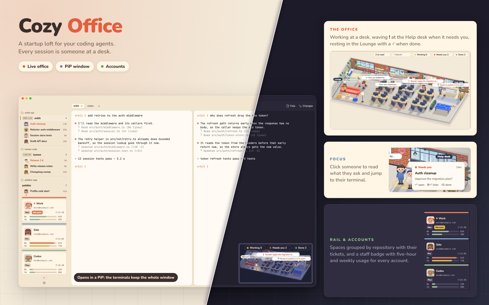

# Cozy Office

A startup loft in brick, concrete and neon for [Herdr](https://herdr.dev). Claude Code, Codex and other agent sessions are a little office: the desks are shared seats, and every session is a person who sits at a desk while it works, goes to the Help desk waving a `!` when it needs you, waits there with a `?` when it wants permission, and ends up in the Lounge with a ✓. The same sessions lie left to right above the office as pocket cards in three groups — Needs you, Working, Done — and the rail on the left is a directory tree: a heading per repository, its spaces with their ticket keys, and one row per agent with a face, a status dot, the topic and how long it has run. Under the rail, staff-ID badges hang for each Claude account with its 5h and weekly usage. The office lives in a PiP: a small window over the terminals that stays where you put it, while a thin tab strip on top leaves the terminals the whole window. The chips in the PiP's top band say how many are Working, wait on you (Needs you) and are Done, with the search and the pages to read (only when there are some).



## Add it

Copy the mods, the layout and the two themes into Herdr's home:

```sh
cp -R mods/cozy-* ~/.config/herdr-app/mods/
mkdir -p ~/.config/herdr-app/layouts ~/.config/herdr-app/themes
cp layouts/cozy-office.json layouts/cozy-office.png ~/.config/herdr-app/layouts/
cp themes/cozy-office-light.json themes/cozy-office-dark.json ~/.config/herdr-app/themes/
for mod in cozy-office cozy-rail cozy-accounts cozy-tabs cozy-pane cozy-editor; do
  herdr-app check ~/.config/herdr-app/mods/$mod
done
```

Merge the `layout:cozy-office` section of this package's `keys.json` into `~/.config/herdr-app/keys.json`, adding its keys without replacing ones you already use, then pick **cozy-office** in Herdr's layout picker.

A session's memo card links its ticket and Slack thread when `mods/cozy-office/site.js` names your Jira and Slack addresses; both are empty here, so those links stay hidden.

## Keys

The PiP takes the keyboard when you click it or the search chip, or press ctrl-alt-p:

| Key | What it does |
| --- | --- |
| ← → | Select the previous / next card |
| ⌥← ⌥→ | Select the first / last card |
| ↩ | Go to the session |
| ⇧↩ | Open its page |
| ⌘↩ | Open the card's links menu |
| ↑ ↓ | Open, scroll and close the card's steps |
| Space / ⇧Space | Go to the next waiting / done session |
| Tab | Open the oldest page to read |
| ⌫ | Dismiss the selected card (mark it seen) |
| ⌘Z | Undo the last dismissal |
| ⌥⌫ | Delete the last search word (searching) |
| Esc | Step back: camera, search, filter, selection, then the keyboard goes back to the pane it came from |

Typing searches the cards; Hangul typed on a 2-set keyboard composes into syllables as you type, and the search chip in the office's top band shows the query. `?` shows the key legend. Every chip in the band has a tooltip; Needs you and Done go to those sessions like Space and Shift+Space, and Working only counts.

The layout's own commands are bound in `keys.json`. Add this section — it applies only while this layout shows:

```json
"layout:cozy-office": {
  "ctrl-alt-p": "cozy-office.toggle",
  "cmd-=": "cozy-office.font_in",
  "cmd-+": "cozy-office.font_in",
  "cmd--": "cozy-office.font_out",
  "cmd-0": "cozy-office.font_reset",
  "cmd-[": "cozy-office.back",
  "cmd-]": "cozy-office.forward"
}
```

When `keys.json` has no `layout:cozy-office` section, `tools/install.sh` prints this section and says to put it inside the file's top-level `{ }` next to `"global"`; the installer never edits `keys.json` itself.

`cmd-=`, `cmd--` and `cmd-0` change the terminals' text size instead of Herdr's zoom, so the office and the cards keep their size. `cmd-[` / `cmd-]` walk back and forward through the terminals focused before.

`ctrl-alt-p` works as in the Chiikawa cards: it gives the keyboard to the PiP, and pressing it again gives it back to the pane it came from. The PiP answers clicks, opens the memo card, shows speech bubbles, and zooms and drags to look around. A click on the PiP gives it the keyboard. The keys of its own move and size it: `alt` + an arrow sends it to that edge of the terminal area (the other axis stays), and `-`, `=` (or `+`) and `0` shrink, grow and reset it holding its near corner while no search is typed. With the mouse, grab the band or the frame and drag it anywhere in the app window to leave it there, over the rail too; a window that starts inside the terminal area is kept inside it, so one dropped past its right or bottom edge is moved back. When the app window changes size, the PiP keeps its distance to the near edges: pulled inside where there is no room, and back to the place it was put once there is. Each corner has a grip, shown while the pointer is over the window: drag one and the opposite corner stays put while the window follows at the new size, stopping at the least and largest sizes and at the terminal area's edges (the app window's, for a window whose top-left is outside that area). The bottom-right grip resizes the window in place; the other three reopen it as a larger see-through drag canvas when pressed (unless the window already reaches the edges on that side) and reopen it at its new place when you let go. The moves and sizes are also commands you can bind directly: `cozy-office.pip_left`, `pip_right`, `pip_up`, `pip_down`, `pip_grow`, `pip_shrink`, `pip_size_reset`.

Pinch on a trackpad, or scroll with `cmd` held, to zoom the PiP's office in and out around the pointer, from the whole room down to a few desks. Drag the room to look around; people, the band's chips and the memo card keep their clicks, and a double-click on the room brings the usual view back. Without `cmd` the wheel does what it did before. The look goes with the PiP when `alt` + an arrow sends it to an edge. The same moves are commands you can bind: `cozy-office.zoom_in`, `zoom_out`, `zoom_reset`, `pan_left`, `pan_right`, `pan_up`, `pan_down`.

## Office states

| Session | Where it is |
| --- | --- |
| Working | At one of the six shared desk islands, facing the monitor |
| Needs you | At the Help desk, waving, with a `!` in the speech bubble |
| Wants permission | At the Help desk, with a `?` in the bubble |
| Done | In the Lounge, cheering with a ✓ |
| Idle (a Done card you have read) | On the Lounge sofa or a beanbag beside it, with a coffee cup |

Everyone in the office says what their session said last in a speech bubble, as on the chiikawa beach: one line from the last sentence of the session's last message, cut at a word. Code blocks, markdown marks and bare URLs are dropped (a link keeps its label), a file path keeps only its last part (a word with two or more slashes that starts with `/`, `~/`, `./` or `../` or ends in a file name, so `src/auth/login.ts:42` reads `login.ts:42` while `2026/11/20` stays as it is), and a spoken lead-in such as "Let me" or "OK," is dropped. While a session is working with no message yet, the bubble names the tool it is running; with neither, it falls back to the topic, then the title. The cards, the rail and the memo card keep the topic, and the PiP says the same lines. Needs you and Wants permission lead with their `!` or `?` in bold and get the longest line, Done leads with its ✓, Working and Done say a shorter line and Idle the shortest, faded. A session with nothing to say shows only its glyph, or no bubble when it is working or idle. Where bubbles overlap, Needs you's and Wants permission's are drawn on top, then Done's, and the one underneath fades; two callers side by side open their bubbles away from each other, and where there is no room for that (at the edge of a small PiP) the left one rises above its neighbour on a longer stem, as long as it stays under the top band; point at a person or their bubble to bring it to the front. Bubbles stay under the top band and inside the office. The framed person's bubble gives way to the memo card.

The card strip follows the same states. A card's band colour, dot and bubble carry its group. When the Help desk or the Lounge is full, the rest show their state at their own desk: a caller stands there with its bubble, a finished session sits there with its ✓, and an idle one sits there with its cup.

A session whose state sends it somewhere else walks there: it stands up, its shadow under it, and crosses the room in a straight line (0.9 to 4 s, by distance) with a small bob each step, then takes its new pose, bubble and halo once it arrives. Everything moves through Herdr's `.transition` and `.loop`, so nothing redraws the window on a timer; a session that stays put, or only changes pose at its own desk, does not walk.

The office is one rectangular room, seen at a turned angle so its long side runs across the screen. Its overview frames the desks, the Help desk and the Lounge under the top 52 px the view's chips keep free, so a wide block crops the room's far and near corners instead of shrinking it.

## Themes

`layouts/cozy-office.json` names `themes/cozy-office-light.json` and `themes/cozy-office-dark.json`; the layout follows Herdr's appearance setting and the mods' colours come from the theme.

## License

MIT for the layout, the themes and `cozy-office`, `cozy-rail`, `cozy-accounts` and `cozy-editor` (`LICENSE`). `mods/cozy-tabs` and `mods/cozy-pane` are modified from Herdr's shipped mods and stay under the Apache License 2.0 (`mods/cozy-tabs/LICENSE`, `mods/cozy-pane/LICENSE`). The bundled Nunito fonts are under the SIL Open Font License 1.1 (`mods/cozy-accounts/fonts/OFL.txt`).
