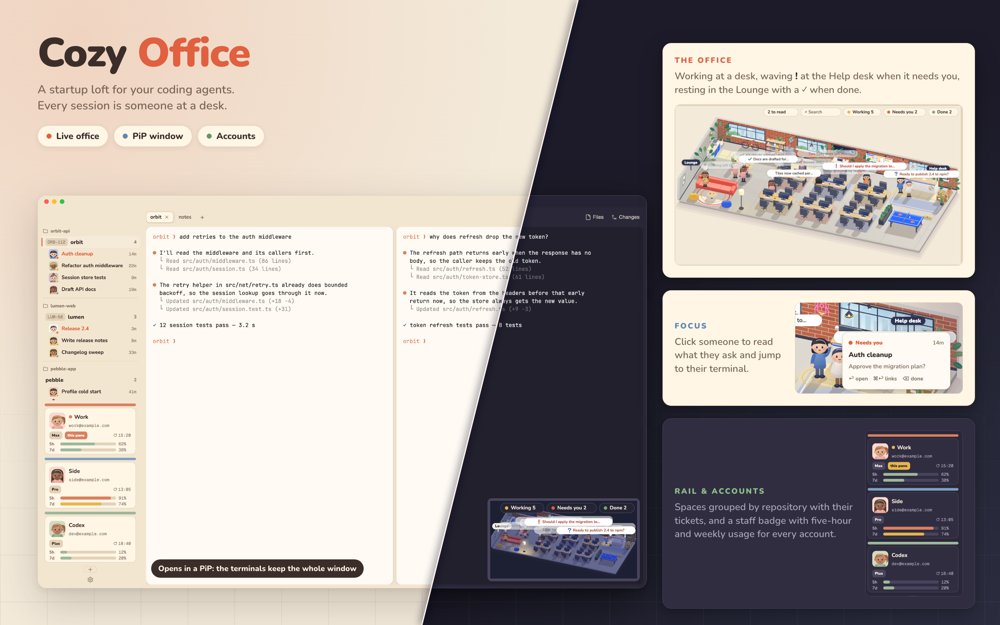

# Cozy Office

A startup loft in brick, concrete and neon for Herdr. Every live Claude Code, Codex or Gemini CLI session is a person in one rectangular office: working sessions sit at six shared desk islands, a session that needs you goes to the Help desk waving a `!`, one that wants permission waits there with a `?`, and finished sessions cheer in the Lounge with a ✓. The office lives in a picture-in-picture window that floats over the terminals and stays where you put it; a 30 px tab strip leaves the terminals the rest of the window. A rail on the left groups the spaces by repository with their ticket keys and agent faces, and staff-ID badges under it show each Claude account's 5h and weekly usage. Every picture is drawn by code; there are light and dark themes.

## What you see

The window is one `row` with `theme: { light: "cozy-office-light", dark: "cozy-office-dark" }`, `background: "chrome"`, no title bar, traffic lights at `[14, 16]` and terminal padding `[14, 12]`.

**Left, the rail, 248 px (200–320, resizable, drags the window), on `chrome`:** three blocks top to bottom.

- **Spaces** (`cozy-rail`, fills the height): a directory tree. A heading per repository, then the spaces cut from it, each with its ticket key and agent count, then one row per agent indented below the space: its face (one of 24), a status dot, the session's topic and how long it has run. A hollow ring by a space means a shell there has sat at its prompt for 10 minutes.
- **Badges** (`cozy-accounts` with `role: "rail"`, 300 px): one staff-ID badge per Claude account: a drawn face, the account label in the bundled Nunito, and its 5h and weekly usage. The accounts popup (260×300) lists the installed agent CLIs, each starting that agent in a pane, with the Claude and Codex accounts under their rows (an account row picks the login new sessions start under), custom commands from `models.json`, and resuming the focused session under another Claude account.
- **Buttons** (`cozy-rail` with `role: "buttons"`, 52 px): the new-space and settings buttons.

**Right, the work column, 8 px padding and gap:**

- **Strip, 30 px, drags the window:** the tab strip (`cozy-tabs`, at least 120 px) and a zero-width `cozy-office` block with `role: "strip"` that owns the PiP. A tab with no name uses its agent session's name, else the folder name. The tabs have no backdrop and sit right against the terminals below.
- **Terminals:** the active tab's panes, radius 12, gap 8, `background` fill, a 2 px `accent` focus border, `lone: true`, the block itself on `chrome` with radius 12 and a small shadow. Each pane has a 30 px `cozy-pane` header on top, always shown: icon, status dot, title, ticket key, split right / split down / zoom / close buttons.

**The PiP, floating:** a window opened with `openOverlay({ kind: "window" })`, 360×196 to start (240×132 to 800×450), placed near the terminal area's bottom-right. A 34 px band runs across its top with chips: **Working**, **Needs you** and **Done** counts, a search chip, a "to read" chip only while a session has a page to read, and an **Overview** chip while one person is in focus. Under it, the office: a brick-and-concrete loft seen at a turned angle so its long side runs across the screen, with six desk islands, a Help desk and a Lounge with a sofa and beanbags. The scene is cropped to the room's width and to the height that holds people, so a wide PiP loses the far and near corners rather than shrinking. Each person stands, sits or walks with a soft shadow, a coloured halo for its state and a speech bubble.

**Speech bubbles.** Each person says one line from the last sentence of its session's last message, cut at a word. Code blocks, markdown marks and bare URLs are dropped (links keep their label), a file path keeps only its last part (`src/auth/login.ts:42` → `login.ts:42`, but `2026/11/20` stays), and spoken lead-ins ("Let me", "OK,") are dropped. With no message yet a working person names the tool it runs, then the topic, then the title. Needs you and Approve lead with a bold `!` / `?` and get the longest line, Done leads with ✓, Working and Done say a shorter line, Idle the shortest, faded.

**The memo card:** clicking a person frames them and opens a card beside them with the topic, the ask or the last line, the checklist steps and links to the ticket, pull request, Slack thread and pages.

**Colour.** From the themes. Light: background `#FFFBF4`, foreground `#3B2E2A`, accent `#D9805F`, chrome `#F3E6D0`, canvas `#F6ECDC`, surface `#FFF6E6`, border `#E3D2B8`, selected `#F6EAD9`, muted `#8A7868`. Dark: background `#22202C`, foreground `#F1E8DA`, accent `#E5B54F`, chrome `#2A2838`, canvas `#262433`, surface `#302D40`, border `#49445E`, selected `#3A3650`, muted `#A9A2B8`. State colours: needs `#E0603F`, approve `#D9805F`, working `#E5B54F`, done `#79A877`, idle `#A39A90`.

## How it behaves

**Agent statuses.**

| Session | Office | Card group |
| --- | --- | --- |
| Working | At a shared desk, facing the monitor | Working |
| Needs you | At the Help desk, waving, `!` bubble | Needs you |
| Wants permission | At the Help desk, `?` bubble | Needs you |
| Done | In the Lounge, cheering, ✓ | Done |
| Idle (a read Done) | On the Lounge sofa or a beanbag, with a coffee cup | Done |

When the Help desk or the Lounge is full, the rest show their state at their own desk. A person whose state moves them stands up and walks there in a straight line (0.9–4 s by distance, a small bob each step), then takes the new pose, bubble and halo. Overlapping bubbles: Needs you and Approve on top, then Done; the one underneath fades. Two callers side by side open their bubbles away from each other; where there is no room (the edge of a small PiP) the left one rises above its neighbour on a longer stem. Pointing at a person brings their bubble to the front.

**Keyboard.** `ctrl-alt-p` gives the keyboard to the PiP and, pressed again, hands it back to the pane it came from; clicking the PiP also takes it. In the PiP: `←`/`→` previous/next person, `⌥←`/`⌥→` first/last, `↩` go to the session, `⇧↩` open its page, `⌘↩` the links menu, `↑`/`↓` open, scroll and close the steps, `Space`/`⇧Space` next waiting / done session, `Tab` oldest page to read, `⌫` dismiss (mark seen), `⌘Z` undo, typing searches (2-set Hangul composes into syllables), `⌥⌫` deletes the last search word, `?` the key legend, `Esc` steps back: camera, search, filter, selection, then the keyboard leaves.

**Moving and sizing the PiP.** `⌥` + an arrow sends it to that edge of the terminal area; `-`, `=`/`+`, `0` shrink, grow and reset it holding its near corner. Drag the band or the frame anywhere in the app window. Each corner has a thin L-shaped grip shown only while the pointer is over the window; dragging one keeps the opposite corner fixed. The bottom-right grip resizes in place; the other three reopen the window as a larger see-through drag canvas reaching that side's edge, then reopen it at the new place on release. The place is stored with the app window size it was set at, and a resized app window keeps the PiP's distance to the near edges without overwriting the stored place.

**Looking around.** Pinch or `⌘`-scroll zooms around the pointer, dragging the room pans, a double-click returns to the usual view. People, chips and the memo card keep their clicks.

**Layout keys** (`keys.json`, section `layout:cozy-office`): `ctrl-alt-p` `cozy-office.toggle`; `cmd-=`/`cmd-+` `font_in`, `cmd--` `font_out`, `cmd-0` `font_reset` (terminal text size, not Herdr zoom); `cmd-[`/`cmd-]` `back`/`forward` through recently focused terminals. Bindable commands also include `pip_left`, `pip_right`, `pip_up`, `pip_down`, `pip_grow`, `pip_shrink`, `pip_size_reset`, `zoom_in`, `zoom_out`, `zoom_reset`, `pan_left`, `pan_right`, `pan_up`, `pan_down`.

**What moves.** Nothing redraws on a timer: walks are one `.transition` per leg, idle motion (typing, waving, cheering, steam from cups, monitor glow) is native `.loop`.

## Built from

**Layout** `layouts/cozy-office.json`: `row` `root` → `rail` column (`rail-spaces` `cozy-rail`; `rail-accounts` 300 px `cozy-accounts` `{role: "rail"}`; `rail-buttons` 52 px `cozy-rail` `{role: "buttons"}`) and `work` column (padding 8, gap 8) → `office-strip` row 30 px (`tabs` `cozy-tabs`, `strip-tools` 0 px `cozy-office` `{role: "strip"}`) and `main` block `{ tab: "active", pane: { header: { content: { mod: "cozy-pane" }, reveal: "always", height: 30, position: "top" }, background: "background", focus: { width: 2, color: "accent" }, radius: 12, gap: 8, lone: true } }`.

**Mods.**

- `cozy-office`: the PiP and the office. `scan.sh` (read-only Python via `sh`) runs every 3 s and prints one JSON line per live session (state, topic, last message, running tool, checklist, pages) plus a meta line. `place.js` seats people at desks, the Help desk and the Lounge and sets the camera; `office-view.js` draws the scene, the band chips, the walks and the bubbles; `pip.js` owns the PiP window, its place and size in `shared()` and the keyboard handoff; `zoom.js` the look on top of the camera; `hangul.js` the search composer; `site.js` the ticket and Slack link patterns (empty in this package).
- `cozy-rail`: the rail tree and its buttons; faces from `faces/*.svg`.
- `cozy-accounts`: the badges and the accounts popup; `cca` does the account shell work, and `usage-tap.sh` is a status-line tap that records each Claude account's rate limits and then runs the original status line.
- `cozy-tabs`: Herdr's shipped `tabs` mod (0.1.12) changed for the 30 px strip.
- `cozy-pane`: Herdr's shipped `pane` header, fitted to the frame.
- `cozy-editor`: not in the layout; `hv <file>` opens a file in an edit pane.

**Art.** `mods/cozy-office/art/{light,dark}`, `art/fx`, `scene-data.js` and the faces are baked SVGs, generated by code (in the source repository, `tools/bake/bake.mjs`). They use no `<filter>`, `<mask>`, `<text>`, `clipPath` or `<image>`.

**Programs.** `python3` (for `scan.sh` and `cca`), `sh`.

## Watch out

- The office shows only in the PiP: the layout has no in-place office block. The zero-width `strip-tools` copy calls `setPip(true)` when it first appears and opens the window; the window copy closes itself when the PiP is off. Moving the PiP means opening it under a new key (`cozy-pip-<gen>`) and closing the old one.
- The root of the PiP must not swallow mouse-down, or Herdr cannot drag the window; only the room, the chips and the grips take the press.
- The scene is cropped to the room's full width and the height people occupy, so a PiP taller than the room shows the whole room and a wider one cuts the top and bottom corners.
- Sizes are clamped to 240×132 through 800×450.
- Bubble text must never show raw paths, code or URLs: strip them before measuring.
- `site.js` ships empty, so the memo card hides ticket and Slack links until you fill in your own addresses.
- `scan.sh` reads Claude Code, Codex and Gemini CLI session files under your home folder; it writes only caches under `${TMPDIR}/herdr-pulse` and never opens `*.key` files.

## Done when

- `herdr-app check` passes for all six mods and the layout switches without errors.
- On switching, the PiP opens over the terminals with the band chips and the office; the counts match the live sessions.
- Starting a Claude Code session puts a person at a desk with a bubble naming its tool; when it asks a question it walks to the Help desk with a `!`; when it finishes it walks to the Lounge with a ✓.
- `ctrl-alt-p` moves the keyboard into the PiP and back; `←`/`→` move the selection and `↩` focuses that session's pane.
- `⌥→` sends the PiP to the right edge; dragging a corner grip resizes it with the opposite corner fixed; the place survives a relaunch.
- Pinch zooms around the pointer and a double-click returns to the usual view.
- The rail lists every space under its repository with agent rows, and the badges show usage for each Claude account.
- Switching Herdr's appearance flips both the chrome and the office art between light and dark.
